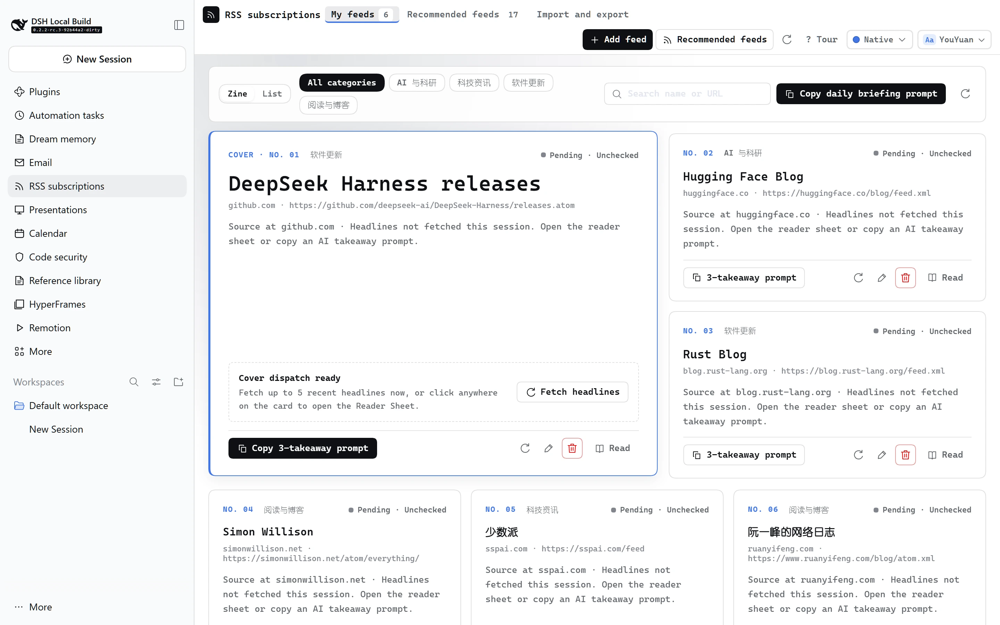

[简体中文](README.md) · **English**

# RSS

**Choose your sources and build a readable feed.**

RSS / Atom workbench for DeepSeek Harness (`>=0.2.2-rc.3`): browse categorized publisher directories, preview before subscribing, search across feeds, and import/export OPML under user control. Features Workbench UI v2 with 5 synced light/warm themes (Native Airy / Warm Cream / Claude Warmth / Bright 8-Bit / Airy Mint), soft-slate dark adaptation, and tactile micro-animations.

[](https://www.npmjs.com/package/dsh-rss) [](https://www.npmjs.com/package/dsh-rss) [](https://www.npmjs.com/package/dsh-rss)

**[Install](#install) · [Workflow](#start-using-it) · [Full guide](https://github.com/STARDUSTLC666/dsh-rss/blob/master/docs/REFERENCE.en.md)**

<picture>
  <source media="(prefers-color-scheme: dark) and (max-width: 640px)" srcset="https://raw.githubusercontent.com/STARDUSTLC666/dsh-rss/master/docs/assets/intro/workflow-en-mobile-dark.svg">
  <source media="(max-width: 640px)" srcset="https://raw.githubusercontent.com/STARDUSTLC666/dsh-rss/master/docs/assets/intro/workflow-en-mobile-light.svg">
  <source media="(prefers-color-scheme: dark)" srcset="https://raw.githubusercontent.com/STARDUSTLC666/dsh-rss/master/docs/assets/intro/workflow-en-dark.svg">
  
</picture>

## Features

- Start with categorized publisher directories or add your own RSS / Atom URLs.
- Preview before subscribing; browsing the catalog never subscribes automatically.
- DeepSeek Harness `>=0.2.2-rc.3` Workbench UI v2 with 5 synced themes (Native Airy, Warm Cream, Claude Warmth, Bright 8-Bit, Airy Mint), tactile micro-animations, and reduced-motion support.
- Filter and search by category, unread state, or keywords, and preview-import or export OPML backups.

<details>
<summary>See an example</summary>



Captured from the live DeepSeek Harness workbench using demo data.

</details>

## Install

Open **Plugins** in the DSH desktop app and install `dsh-rss`. If the CLI is available:

```bash
dsh plugin --profile desktop add dsh-rss
```

For the web profile, replace `desktop` with `web`. Restart that DSH profile after installation. The package’s DSH requirement is `>=0.2.2-rc.3`.

## Start using it

Use RSS in a smooth **Preview & subscribe → Organize / import OPML → Copy 1-click prompt for AI briefings** loop:

1. **Preview & subscribe**: Open **RSS subscriptions** from the sidebar, preview recent entries in **Recommended feeds** before subscribing, or enter your own publisher RSS / Atom URL (browsing the catalog never subscribes or contacts sites automatically).
2. **Organize categories & OPML**: Filter by category, edit feed groups, and check feed health in **My feeds**, or preview-import and export OPML backups in **Import and export**.
3. **Copy 1-click prompt for AI briefings**: Click **Copy daily briefing prompt** in **My feeds** or **Copy 3-takeaway prompt** inside any feed detail, then paste into a DSH chat so the assistant fetches updates and summarizes key insights with source links.

Handy chat prompts (1-click copyable in the workbench):

- `Fetch the latest articles from my subscribed feeds and generate today’s key briefing by category`
- `Fetch the latest updates from “<Feed Title>” and distill 3 key takeaways`
- `Summarize these articles I have read, keep source links, and distinguish reported facts from speculation`

## Before you start

External availability depends on the publisher and network. Proxy configuration is optional.

Configuration, detailed tools and troubleshooting: [full reference](https://github.com/STARDUSTLC666/dsh-rss/blob/master/docs/REFERENCE.en.md).

## Plugin updates

Check updates at the bottom of the workbench or native plugin details. Automatic checks are on by default; **automatic installation is off**. You choose whether to install and when to restart. Suite-managed components update with their bundle. [Update behavior](https://github.com/STARDUSTLC666/dsh-rss/blob/master/docs/REFERENCE.en.md).

## Documentation

- [Full usage, configuration and limits](https://github.com/STARDUSTLC666/dsh-rss/blob/master/docs/REFERENCE.en.md)
- [Release notes](https://github.com/STARDUSTLC666/dsh-rss/blob/master/CHANGELOG.md)
- [Validation scope and history](https://github.com/STARDUSTLC666/dsh-rss/blob/master/docs/VALIDATION.md)

## Feedback and contributions

If the plugin helps, a Star makes it easier for others to discover. Report problems or suggest improvements in [Issues](https://github.com/STARDUSTLC666/dsh-rss/issues); code and documentation [PRs](https://github.com/STARDUSTLC666/dsh-rss/pulls) are welcome. Include versions and reproduction steps, and remove credentials from reports.

## License

[MIT](https://github.com/STARDUSTLC666/dsh-rss/blob/master/LICENSE)

<a id="what-it-does"></a>
<a id="requirements-and-configuration"></a>

Publisher listing and removal: [catalog policy](docs/CATALOG-POLICY.en.md).
