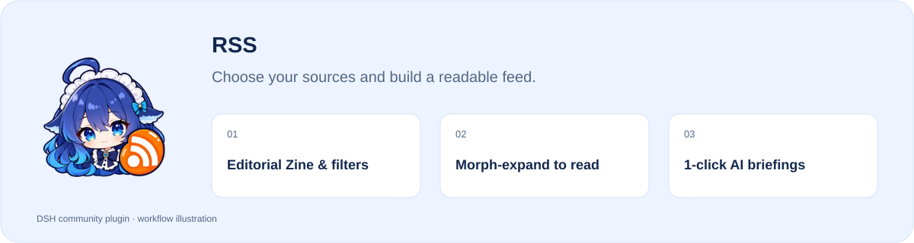

[简体中文](README.md) · **English**

# RSS

**Choose your sources and build a readable feed.**

RSS / Atom workbench for DeepSeek Harness (`>=0.2.2-rc.3`): opens by default in an **Editorial Zine Spread** (12-column asymmetric magazine layout with native View Transitions expand/collapse into a centered Reader Sheet, plus 1-click toggle back to classic List split view), alongside categorized publisher previews, multi-feed search, and OPML preview import/export. Includes 13 synced bright themes (Native Airy, Gazette, Riso Zine, Song Xuan, E-Ink, etc. with soft-slate dark adaptation) and 8 dual-layer font pairings (`YouYuan Mono` default).

[](https://www.npmjs.com/package/dsh-rss) [](https://www.npmjs.com/package/dsh-rss) [](https://www.npmjs.com/package/dsh-rss)

**[Install](#install) · [Workflow](#start-using-it) · [Full guide](https://github.com/STARDUSTLC666/dsh-rss/blob/master/docs/REFERENCE.en.md)**

<picture>
  <source media="(prefers-color-scheme: dark) and (max-width: 640px)" srcset="https://raw.githubusercontent.com/STARDUSTLC666/dsh-rss/master/docs/assets/intro/workflow-en-mobile-dark.svg">
  <source media="(max-width: 640px)" srcset="https://raw.githubusercontent.com/STARDUSTLC666/dsh-rss/master/docs/assets/intro/workflow-en-mobile-light.svg">
  <source media="(prefers-color-scheme: dark)" srcset="https://raw.githubusercontent.com/STARDUSTLC666/dsh-rss/master/docs/assets/intro/workflow-en-dark.svg">
  
</picture>

## Features

- **Editorial Zine Spread (default) + 1-click List view**: **My feeds** opens as an asymmetric 12-column magazine spread (7-col Lead Hero Story + 5-col stacked Feature Dispatches + 3-col Bento Story Grid) with native `document.startViewTransition()` expand/collapse into a centered Reader Sheet, and a compact **Zine / List** toggle to switch back anytime.
- Start with categorized publisher directories or add your own RSS / Atom URLs; preview before subscribing without automatic background fetching.
- DeepSeek Harness `>=0.2.2-rc.3` workbench with 13 synced themes, 8 font pairings (`YouYuan Mono` default), tactile micro-animations, reduced-motion support, and interactive **? Tour** walkthroughs.
- Floating category filter pills, instant search, 1-click AI daily/per-feed briefing prompts, and OPML preview import/export backups.

<details>
<summary>See an example</summary>


Captured from the live DeepSeek Harness workbench using demo data.

</details>

## Install

Open **Plugins** in the DSH desktop app and install `dsh-rss`. If the CLI is available:

```bash
dsh plugin --profile desktop add dsh-rss
```

For the web profile, replace `desktop` with `web`. Restart that DSH profile after installation. The package’s DSH requirement is `>=0.2.2-rc.3`.

## Start using it

Use RSS in a fluid **Editorial Zine & filter → Morph-expand to read → 1-click AI briefings** loop (click **? Tour** in the header anytime for a guided walkthrough):

1. **Filter & curate on the Editorial Zine Desk**: Open **RSS subscriptions** from the sidebar to land on the default **Zine** spread. Filter with floating category pills and instant search, or click **Zine / List** to toggle the classic split list. Add feeds via **Recommended feeds** (preview before subscribing), **Add feed**, or OPML preview import under **Import and export**.
2. **Morph-expand any card into the Reader Sheet**: Click the Hero Story, Feature Dispatch, or Bento cards to smoothly morph into a centered **Editorial Reader Sheet** via View Transitions. Click **Check updates** to fetch up to 5 recent articles, edit metadata, or click **Back to zine desk** to morph smoothly back.
3. **Copy 1-click AI briefing prompts**: Click **Copy daily briefing prompt** in the floating editorial strip or **Copy 3-takeaway prompt** on any Hero card / Reader Sheet, then paste into chat so AI fetches updates and summarizes key insights with source links.

Handy chat prompts (1-click copyable in the workbench):

- `Fetch the latest articles from my subscribed feeds and generate today’s key briefing by category`
- `Fetch the latest updates from “<Feed Title>” and distill 3 key takeaways`
- `Summarize these articles I have read, keep source links, and distinguish reported facts from speculation`

## Before you start

External availability depends on the publisher and network. Proxy configuration is optional.

Configuration, detailed tools and troubleshooting: [full reference](https://github.com/STARDUSTLC666/dsh-rss/blob/master/docs/REFERENCE.en.md).

## Plugin updates

Check updates at the bottom of the workbench or native plugin details. Automatic checks are on by default; **automatic installation is off**. You choose whether to install and when to restart. Suite-managed components update with their bundle. [Update behavior](https://github.com/STARDUSTLC666/dsh-rss/blob/master/docs/REFERENCE.en.md).

## Documentation

- [Full usage, configuration and limits](https://github.com/STARDUSTLC666/dsh-rss/blob/master/docs/REFERENCE.en.md)
- [Release notes](https://github.com/STARDUSTLC666/dsh-rss/blob/master/CHANGELOG.md)
- [Validation scope and history](https://github.com/STARDUSTLC666/dsh-rss/blob/master/docs/VALIDATION.md)

## Feedback and contributions

If the plugin helps, a Star makes it easier for others to discover. Report problems or suggest improvements in [Issues](https://github.com/STARDUSTLC666/dsh-rss/issues); code and documentation [PRs](https://github.com/STARDUSTLC666/dsh-rss/pulls) are welcome. Include versions and reproduction steps, and remove credentials from reports.

## License

[MIT](https://github.com/STARDUSTLC666/dsh-rss/blob/master/LICENSE)

<a id="what-it-does"></a>
<a id="requirements-and-configuration"></a>

Publisher listing and removal: [catalog policy](docs/CATALOG-POLICY.en.md).
