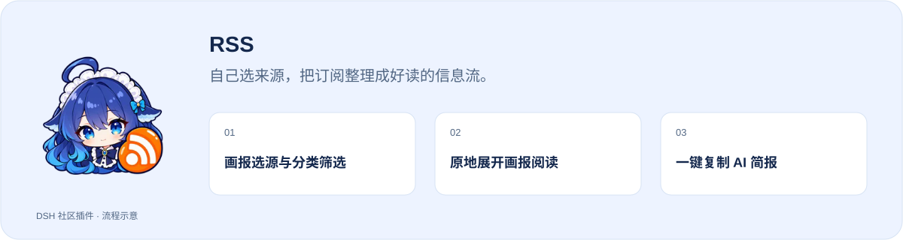

**简体中文** · [English](README.en.md)

# RSS

> **自己选来源，把 RSS / Atom 订阅整理成杂志级清爽信息流。**

DeepSeek Harness（`>=0.2.2-rc.3`）订阅工作台：默认 **「编辑部画报桌面」**（12 栏非对称排版 + View Transitions 原地展开阅读单，1 键切回经典列表），内置 13 套明亮风格 × 8 套双层字体。

[](https://www.npmjs.com/package/dsh-rss) [](https://www.npmjs.com/package/dsh-rss) [](https://www.npmjs.com/package/dsh-rss)

**[核心能力](#核心能力) · [安装](#安装) · [快速上手](#开始使用) · [完整说明](https://github.com/STARDUSTLC666/dsh-rss/blob/master/docs/REFERENCE.zh.md)**

<picture>
  <source media="(prefers-color-scheme: dark) and (max-width: 640px)" srcset="https://raw.githubusercontent.com/STARDUSTLC666/dsh-rss/master/docs/assets/intro/workflow-zh-mobile-dark.svg">
  <source media="(max-width: 640px)" srcset="https://raw.githubusercontent.com/STARDUSTLC666/dsh-rss/master/docs/assets/intro/workflow-zh-mobile-light.svg">
  <source media="(prefers-color-scheme: dark)" srcset="https://raw.githubusercontent.com/STARDUSTLC666/dsh-rss/master/docs/assets/intro/workflow-zh-dark.svg">
  
</picture>

## 核心能力

| 模块 | 核心特性 |
| :--- | :--- |
| **编辑部画报桌面** | 12 栏非对称杂志排布（封面头条 + 精选快讯 + Bento 故事网格），点击卡片通过原生 View Transitions 原地展开居中阅读单；1 键切回经典双栏「列表」 |
| **先预览再订阅** | 内置分类推荐目录并支持自定义 RSS / Atom 地址，浏览目录不自动抓取或擅自订阅 |
| **筛选、检索与 OPML** | 悬浮分类胶囊筛选、多源全文检索、OPML 预览导入与一键导出备份 |
| **AI 简报协同与外观** | 内置一键复制「今日简报 / 单源提炼」对话指令；配备 `? 引导` 分步导览、13 套明亮风格与 8 套双层字体（默认跟随风格专属字） |

<details>
<summary>查看工作台实景截图（编辑部画报桌面）</summary>


图片来自验证环境的真实工作台界面，使用示例数据。

</details>

## 安装

在 DSH 桌面版「插件」面板安装 `dsh-rss`，或使用命令行：

```bash
dsh plugin --profile desktop add dsh-rss
```

网页版将 `desktop` 改为 `web`，安装后重启 DSH。宿主要求：`>=0.2.2-rc.3`。

## 开始使用

1. **画报桌选源与筛选**：从左侧栏打开「RSS 订阅」进入画报桌面，用悬浮分类胶囊或搜索框筛选（随时切回「列表」）；首次可在「推荐订阅源」先预览再订阅，或预览导入 OPML。
2. **原地展开居中阅读单**：点击任意画报卡片平滑展开阅读单，点击「检查更新」拉取近期头条、编辑分类或移除订阅，点「← 收拢回画报桌」返回。
3. **一键复制 AI 简报指令**：点击悬浮条或阅读单内的快捷复制按钮，粘贴到 DSH 对话即可生成带原文链接的每日重点简报。

### 常用对话示例

- **每日重点简报**：`抓取我订阅源的最新文章，按分类生成今日重点简报`
- **单源要点提炼**：`抓取「<订阅源名称>」最新更新并提炼 3 条核心结论`
- **事实与推测分离**：`整理我已读取的这些订阅文章，保留原文链接，并区分报道事实与推测`

## 开始前要知道

- 单个源访问失败时，可单独配置 HTTP、HTTPS 或 SOCKS5 代理。[查看 Hacker News 配置示例](docs/USAGE.md#代理与-vpn)。
- 出版者收录与移除规则见 [目录规则](docs/CATALOG-POLICY.md)；详细配置与排错见 [完整说明](https://github.com/STARDUSTLC666/dsh-rss/blob/master/docs/REFERENCE.zh.md)。

## 插件更新

在工作台或原生插件详情页底部检查更新。默认自动检查，**默认不自动安装**；Suite 管理的组件随整包更新。

## 文档与反馈

- [完整使用、配置与边界](https://github.com/STARDUSTLC666/dsh-rss/blob/master/docs/REFERENCE.zh.md) · [更新记录](https://github.com/STARDUSTLC666/dsh-rss/blob/master/CHANGELOG.md) · [验证历史](https://github.com/STARDUSTLC666/dsh-rss/blob/master/docs/VALIDATION.md)
- 欢迎 Star、提交 [Issues](https://github.com/STARDUSTLC666/dsh-rss/issues) 与 [PR](https://github.com/STARDUSTLC666/dsh-rss/pulls)（反馈请附版本与复现步骤，并移除凭据）。

## License

[MIT](https://github.com/STARDUSTLC666/dsh-rss/blob/master/LICENSE)

<a id="依赖与配置"></a>
