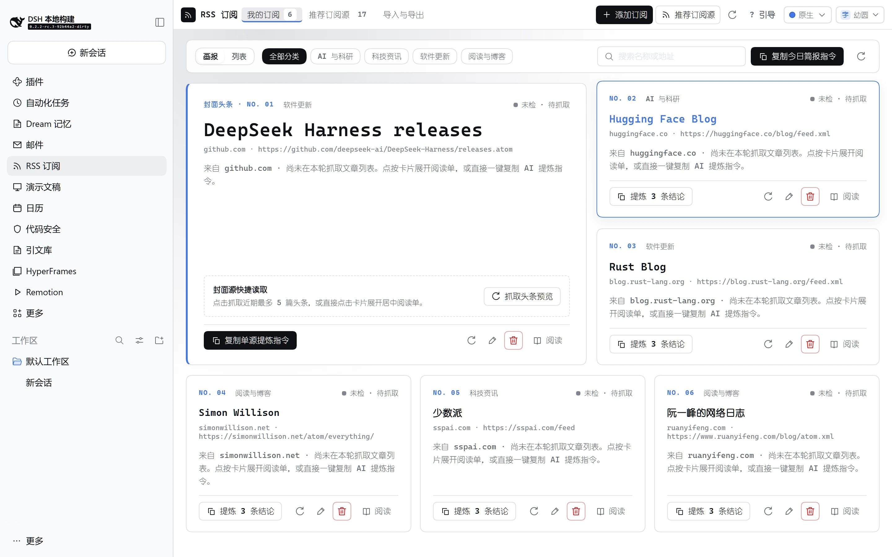

**简体中文** · [English](README.en.md)

# RSS

**自己选来源，把订阅整理成好读的信息流。**

DeepSeek Harness（`>=0.2.2-rc.3`）RSS / Atom 订阅工作台：**默认「编辑部画报桌面（Editorial Zine Spread）」** 12 栏非对称封面排布 + 原生 View Transitions 原地展开居中阅读单，支持一键切回经典「列表」双栏视图、分类推荐目录先预览后订阅、多源检索与 OPML 预览导入导出。工作台内置 13 套明亮可切换界面风格（原生清透 / 铅字晨报 / 波普孔版 / 宋韵朱砂 / 护眼墨水屏等，深色模式自动柔和适配）与 8 套中英文字体搭配（默认幼圆等宽），跨插件实时同步。

[](https://www.npmjs.com/package/dsh-rss) [](https://www.npmjs.com/package/dsh-rss) [](https://www.npmjs.com/package/dsh-rss)

**[安装使用](#安装) · [使用流程](#开始使用) · [完整说明](https://github.com/STARDUSTLC666/dsh-rss/blob/master/docs/REFERENCE.zh.md)**

<picture>
  <source media="(prefers-color-scheme: dark) and (max-width: 640px)" srcset="https://raw.githubusercontent.com/STARDUSTLC666/dsh-rss/master/docs/assets/intro/workflow-zh-mobile-dark.svg">
  <source media="(max-width: 640px)" srcset="https://raw.githubusercontent.com/STARDUSTLC666/dsh-rss/master/docs/assets/intro/workflow-zh-mobile-light.svg">
  <source media="(prefers-color-scheme: dark)" srcset="https://raw.githubusercontent.com/STARDUSTLC666/dsh-rss/master/docs/assets/intro/workflow-zh-dark.svg">
  
</picture>

## 功能

- **编辑部画报桌面（默认）+ 经典列表一键切换**：`我的订阅` 默认以 12 栏非对称杂志画报呈现（7 栏封面头条 + 5 栏精选快讯 + 3 栏 Bento 故事网格），点击任意卡片通过原生 View Transitions 原地平滑展开居中阅读单；顶部支持一键切回经典「列表」双栏视图。
- 从分类来源目录开始，也能添加自己的 RSS / Atom 地址；预览后再订阅，浏览目录不会自动添加或抓取来源。
- 适配 DeepSeek Harness `>=0.2.2-rc.3` 的统一工作台，内置 13 套明亮主题、8 套字体搭配（默认幼圆等宽）、微交互动效与 `? 引导` 分步导览。
- 悬浮分类胶囊筛选、实时检索、一键复制 AI 每日简报/单源提炼指令，以及 OPML 预览导入与导出备份。

<details>
<summary>查看实际示例</summary>



图片来自验证环境的真实工作台界面，使用示例数据。

</details>

## 安装

在 DSH 桌面版「插件」面板安装 `dsh-rss`。已配置命令行时也可使用：

```bash
dsh plugin --profile desktop add dsh-rss
```

网页版把 `desktop` 改为 `web`；安装后重启对应的 DSH。宿主要求以包声明 `>=0.2.2-rc.3` 为准。

## 开始使用

推荐按 **「画报选源与分类筛选 → 点击卡片原地展开阅读 → 一键复制 AI 简报指令」** 的节奏使用（随时可点右上角 `? 引导` 交互导览）：

1. **画报桌选源与分类筛选**：从左侧栏打开「RSS 订阅」，默认进入 **「画报」编辑部桌面**，通过顶部悬浮分类胶囊（`全部分类` + 自定义分类）和搜索框即时筛选，也可点击 **`画报 / 列表`** 一键切回经典双栏列表；初次使用可在「推荐订阅源」先预览近期文章再订阅，或点「添加订阅」输入原生 RSS / Atom 地址，或在「导入与导出」预览导入 OPML。
2. **点击卡片原地展开居中阅读单**：点击 12 栏画报中的封面头条、精选快讯或 Bento 卡片，页面通过 View Transitions 原地展开为居中 **Editorial Reader Sheet**，可点击「检查更新」拉取最多 5 篇近期头条、编辑分类或移除订阅，点 **「← 收拢回画报桌」** 平滑返回。
3. **一键复制 AI 简报指令**：点击悬浮条 **「复制今日简报指令」** 或卡片/阅读单里的 **「复制单源提炼指令」**，粘贴到 DSH 对话即可让助手按分类或单源抓取最新更新、提炼核心结论并附上原文链接。

常用对话指令（工作台内支持一键复制）：

- `抓取我订阅源的最新文章，按分类生成今日重点简报`
- `抓取「<订阅源名称>」最新更新并提炼 3 条核心结论`
- `整理我已读取的这些订阅文章，保留原文链接，并区分报道事实与推测`

## 开始前要知道

外部来源的可达性由网站与网络决定；代理是可选配置。

配置、完整工具与排错见[详细使用说明](https://github.com/STARDUSTLC666/dsh-rss/blob/master/docs/REFERENCE.zh.md)。

## 插件更新

在工作台或原生插件详情页底部检查更新。默认自动检查，**默认不自动安装**；是否安装、何时重启由你决定。Suite 管理的组件随整包更新。[查看更新规则](https://github.com/STARDUSTLC666/dsh-rss/blob/master/docs/REFERENCE.zh.md)。

## 文档

- [详细使用、配置与边界](https://github.com/STARDUSTLC666/dsh-rss/blob/master/docs/REFERENCE.zh.md)
- [更新记录](https://github.com/STARDUSTLC666/dsh-rss/blob/master/CHANGELOG.md)
- [验证范围与历史](https://github.com/STARDUSTLC666/dsh-rss/blob/master/docs/VALIDATION.md)

## 反馈与贡献

如果插件帮到了你，欢迎 Star，让更多人发现它。问题和建议请提交 [Issues](https://github.com/STARDUSTLC666/dsh-rss/issues)，也欢迎代码与文档 [PR](https://github.com/STARDUSTLC666/dsh-rss/pulls)。反馈时附上版本与复现步骤，并移除凭据。

## License

[MIT](https://github.com/STARDUSTLC666/dsh-rss/blob/master/LICENSE)

<a id="依赖与配置"></a>

出版者收录与移除：[目录规则](docs/CATALOG-POLICY.md)。
